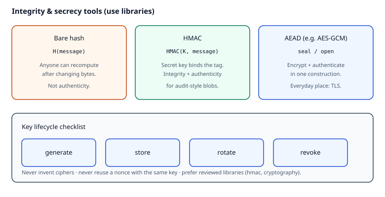

# Reading — Crypto hygiene (`crypto_hygiene`)

## Learning objectives

By the end of this kata’s reading + worksheet + implementation, you should be able to:

1. Explain why a bare hash is the wrong tool for message **integrity** when an attacker can modify bytes — and why Hash-based Message Authentication Code (**HMAC**) binds a secret key to the hash.
2. Describe Authenticated Encryption with Associated Data (**AEAD**) as “encrypt + authenticate in one construction,” and name Transport Layer Security (**TLS**) as the everyday place AEAD (and certificates) show up.
3. State a short **key lifecycle** checklist (generate, store, rotate, revoke) and refuse to invent ciphers — use reviewed libraries instead.

## Short intro

Time-based One-Time Password (**TOTP**) already taught “don’t hand-roll HMAC.” This kata widens the lens: integrity tags for audit-style blobs, and AEAD for secrets at rest (or in transit below TLS). You will call Python’s `hmac` module and the `cryptography` library’s AES-GCM — not design modes yourself.

*Figure. A bare hash is not authenticity when an attacker can change bytes; **HMAC** binds a secret key; **AEAD** encrypts and authenticates together (TLS is the everyday place this shows up). Notice the key lifecycle strip — generate, store, rotate, revoke — and the rule to use reviewed libraries. Original course diagram (CC0).*

**TLS** (Transport Layer Security) is the protocol that protects HTTP and SMTP connections: the server presents an X.509 **certificate** (a signed binding of public key ↔ name), the client verifies the chain to a trusted root, then both sides negotiate an AEAD cipher suite. You will not implement TLS here; you *will* practice the same misuse rules TLS libraries already enforce — never reuse a nonce with the same key, never skip authentication, never treat “encrypt with raw AES-ECB” as done.

## Videos (verified)

1. **[Public Key Cryptography - Computerphile](https://www.youtube.com/watch?v=GSIDS_lvRv4)** — Computerphile (feat. Dr Mike Pound)  
   Why it helps: mental model for public/private keys before certificates feel magical.

2. **[TLS Handshake Explained](https://www.youtube.com/watch?v=86cQJXauvZ0)** — ByteByteGo  
   Why it helps: certificate check → key agreement → encrypted application data, without drowning in RFCs.

3. **[AES Explained (Advanced Encryption Standard)](https://www.youtube.com/watch?v=O4xNJsjtN6E)** — Computerphile (feat. Dr Mike Pound)  
   Why it helps: intuition for the block cipher under AES-GCM — then remember this kata uses **AEAD** (GCM), not raw ECB.

## Read these (verified)

### Specs & libraries

1. [RFC 2104 — HMAC](https://datatracker.ietf.org/doc/html/rfc2104) — keyed hashing for integrity/authenticity.
2. [Python `hmac` — cryptographic message authentication](https://docs.python.org/3/library/hmac.html) — `hmac.new`, `compare_digest`.
3. [PyCA cryptography — AESGCM](https://cryptography.io/en/latest/hazmat/primitives/aead/#cryptography.hazmat.primitives.ciphers.aead.AESGCM) — AEAD seal/open API you will call.

### Concepts & security literacy

4. [OWASP Cryptographic Storage Cheat Sheet](https://cheatsheetseries.owasp.org/cheatsheets/Cryptographic_Storage_Cheat_Sheet.html) — algorithms, key management, common failures.
5. [MDN — Transport Layer Security (TLS)](https://developer.mozilla.org/en-US/docs/Web/Security/Transport_Layer_Security) — what browsers verify and why mixed content breaks the model.
6. [Latacora — Cryptographic Right Answers](https://www.latacora.com/blog/2018/04/03/cryptographic-right-answers/) — opinionated “what to use” list (pair with current library docs).

### Why this kata exists (career prep)

7. Cloud security SaaS work expects engineers to *consume* crypto correctly (TLS termination, secret storage, HMAC webhooks) — not invent primitives.
8. MailGuard’s audit and secure-transfer paths need integrity and confidentiality literacy even when the product story is DLP, not a crypto product.

## Optional deepeners

- [NIST SP 800-57 Part 1 Rev. 5 — Recommendation for Key Management](https://csrc.nist.gov/pubs/sp/800/57/pt1/r5/final) — lifecycle vocabulary (generate, distribute, store, rotate, destroy).
- Skim certificate fields in a browser’s certificate viewer once after the kata is green.

## Quiz (required)
After this reading: [`../quizzes/crypto_hygiene.md`](../quizzes/crypto_hygiene.md).
