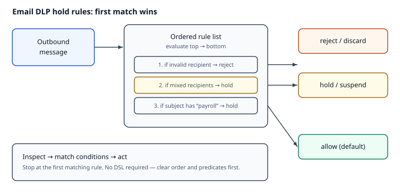

# Reading — Hold rules

## Learning objectives

By the end of this kata’s reading + assignment + implementation, you should be able to:

1. Describe email Data Loss Prevention (DLP) as ordered policy: match conditions → action (allow / hold-suspend / reject-discard).
2. Implement **first-match-wins** evaluation over a small rule list without inventing a Domain-Specific Language (DSL).
3. Connect the toy engine to real product language (Microsoft Purview / Google Workspace DLP and similar SaaS email guards) so you can explain trade-offs in an interview.

**Why this matters.** Without outbound policy, sensitive mail leaves the org the moment someone hits Send — autocomplete mistakes and rushed CCs are expensive. Email Data Loss Prevention (DLP) exists so messages are inspected and acted on *before* delivery. On the job, SaaS email guards and security gateways all share the same inspect → match → act shape; this kata trains that vocabulary without a product lock-in.

Email DLP products sit between sender and recipient and apply **policy**: allow, temporarily hold (suspend), or reject/discard. Admins express rules; engines evaluate messages in a defined order. This kata is a **tiny** version of that idea — domain and substring predicates, **first match wins**, no DSL. The point is clear specs and concise Python, not a production rule language.

**How it works.**

1. Inspect the outbound message (recipients, subject, body — whatever predicates the engine supports).
2. Walk an **ordered** rule list from top to bottom.
3. For each rule, evaluate its predicates (e.g. recipient domain, substring in subject/body).
4. On the **first** matching rule, apply its action: **allow**, **hold/suspend**, or **reject/discard** — then stop.
5. If nothing matches, apply the engine’s default (documented in the kata/tests). Order *is* policy: swapping two rules can change outcomes for the same mail.



*Figure. Inspect the message, walk the ordered rule list, and stop at the **first match**. Notice the three actions — allow, hold/suspend, reject/discard — and that evaluation order is part of the policy, not an afterthought. Original course diagram (CC0).*

### Worked example

```text
Rules (top → bottom):
  1. if subject contains "payroll"     → hold
  2. if any recipient domain != org.com → reject
  3. else                              → allow   (or default)

Message: To: alice@org.com, Subject: "Q4 payroll draft"
Evaluation: rule 1 matches → hold (rule 2 never runs)
```

If rule 2 were listed first, an internal payroll draft to `alice@org.com` would **allow** (no external domain) and never reach the payroll hold — same predicates, different order, different outcome.

Real email DLP products share this shape: rules that allow, suspend, or discard to prevent costly mis-sends of sensitive information. MailGuard later folders reuse the same allow / hold / reject vocabulary.

### Common misconceptions / what goes wrong

- **“All matching rules fire.”** First-match-wins means later rules are invisible once one matches — that is why order is part of the policy, not cosmetic.
- **“A hold engine replaces SPF/DKIM/DMARC.”** Holds catch *outbound* mistakes; domain authentication stops *inbound* spoof. Different problems.
- **“More predicates always mean better security.”** An unreadable DSL you cannot explain in an interview (or debug at 2 a.m.) fails operationally; start with clear order and tiny predicates.
- **“Default allow with no final rule is fine.”** Undocumented defaults surprise operators; tests should pin what happens when nothing matches.

## Videos (verified)

1. **[What is Data Loss Prevention (DLP)?](https://www.youtube.com/watch?v=meWpZCmV0dg)** — Google Workspace  
   Why it helps: short official intro to DLP as **rules** that scan content and enforce an action when a rule matches.

2. **[Data Loss Prevention across endpoints, apps, & services | Microsoft Purview](https://www.youtube.com/watch?v=hvqq8L_0kgI)** — Microsoft Mechanics  
   Why it helps: shows how one DLP policy idea spans email and other channels — same “inspect → match → act” loop as this kata, at product scale.

3. **[Plan and design Data Loss Prevention (DLP) Policies | SC-401 | Episode 5](https://www.youtube.com/watch?v=Agp8I97XHlk)** — Microsoft Learn  
   Why it helps: policy design (what to monitor, where, conditions, actions) maps cleanly onto ordered hold/allow/reject rules.

## Read these (verified)

### Product / domain context

1. [What is Data Loss Prevention (DLP)? — Google Workspace](https://support.google.com/a/answer/9646351) — rules that scan content and enforce actions.
2. [Microsoft Purview Data Loss Prevention](https://learn.microsoft.com/en-us/purview/dlp-learn-about-dlp) — protection, detection, and response framing for email and sharing.
3. Challenge bar for this kata: short, elegant solutions — keep the engine interview-explainable.

### Engineering craft for this kata

4. [Python `dataclasses`](https://docs.python.org/3/library/dataclasses.html) — frozen message/rule records as used in the stub.
5. [pytest — Get Started](https://docs.pytest.org/en/stable/getting-started.html) — tests are the contract; run them often.

### Missend / privacy literacy (why “hold” exists)

6. [NZ Privacy Commissioner — prevent privacy breaches through email](https://www.privacy.org.nz/resources-and-learning/knowledge-base/view/516/) — wrong recipient is a top reported breach; check recipients; delays/reminders help.
7. [OVIC — tips to reduce data breaches when sending emails](https://ovic.vic.gov.au/privacy/resources-for-organisations/tips-to-reduce-data-breaches-when-sending-emails/) — human error, verify full addresses, delay-send patterns.

## Keep in mind

Production DLP adds attachment inspection, admin UX, queues, and richer matching. Your kata stays dumb on purpose — interview-explainable order and predicates first. Later MailGuard folders (API, Go workers, Vue admin, AWS) extend this toy engine toward a fuller SaaS shape.

## Next step

Continue with the assignment from the downloads on this page. The quiz is required after you attempt the assignment and tests.
