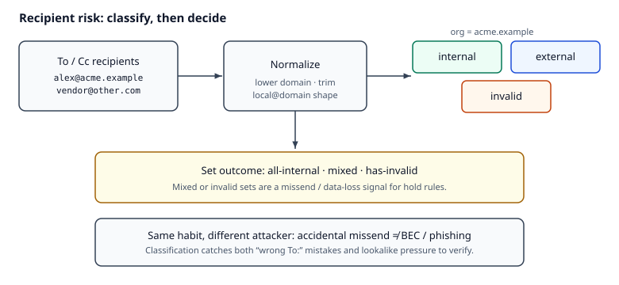

# Reading — Recipient risk

## Learning objectives

By the end of this kata’s reading + assignment + implementation, you should be able to:

1. Classify recipients as internal / external / invalid against an org domain after simple normalization.
2. Explain why **mixed** or **invalid** recipient sets are a missend / data-loss signal that can feed a hold rule.
3. Distinguish accidental missends from **Business Email Compromise (BEC)** / phishing — same “verify the recipient” habit, different attacker model.

**Why this matters.** Accidental missends (internal + external in one To/Cc) and invalid addresses leak data or bounce into the wrong inbox. Without a recipient-risk signal, hold rules have nothing principled to trigger on. On the job, the same “verify the recipient” habit shows up in DLP products and in Business Email Compromise (BEC) playbooks — different attacker models, same classification step.

**How it works.** Normalize each address (strip, lowercase domain), then classify as **internal**, **external**, or **invalid** against the org domain. A set that is **mixed** or contains **invalid** addresses is a missend / data-loss signal that can feed a hold rule. This kata uses a simple `local@domain` shape — not full RFC 5322 — so the contract stays testable.

*Figure. Normalize first, then classify each address against the org domain. Notice that **mixed** or **invalid** set outcomes are the missend signal — the same “verify the recipient” habit applies to accidents and to BEC pressure, with different attacker models. Original course diagram (CC0).*

Pair this with the hold-rules kata: risk signals often feed “should we hold?” policies in email Data Loss Prevention (DLP) products.

## Videos (verified)

1. **[FBI Warns of Business Email Compromise Scams](https://www.youtube.com/watch?v=cBcjTJmxgh4)** — FBI – Federal Bureau of Investigation  
   Why it helps: official framing of BEC — lookalike addresses and payment requests; reinforces **verify the recipient** before trusting mail.

2. **[PSA: Business E-Mail Compromise Scams](https://www.youtube.com/watch?v=u3nAeVNSV24)** — FBI – Federal Bureau of Investigation  
   Why it helps: short dramatization of a rushed wire on a suspicious “boss” email — same urgency/missend pressure DLP holds interrupt.

3. **[Recognize and Report Phishing](https://www.youtube.com/watch?v=9pTW-F6V2N0)** — CISA  
   Why it helps: quick checklist for sender/address mismatch and odd urgency — literacy that pairs with programmatic recipient classification.

## Read these (verified)

### Email address handling

1. [Open Worldwide Application Security Project (OWASP) Email Validation and Verification Cheat Sheet](https://cheatsheetseries.owasp.org/cheatsheets/Email_Validation_and_Verification_Cheat_Sheet.html) — normalize before compare; don’t invent brittle regex empires; domain lowercasing.
2. [RFC 5321 — SMTP](https://datatracker.ietf.org/doc/html/rfc5321) — skim address / mailbox concepts (optional depth after the kata is green).
3. [RFC 5322 — Internet Message Format](https://datatracker.ietf.org/doc/html/rfc5322) — full address syntax is richer than this kata; know the gap.

### Missend / DLP motivation

4. [NZ Privacy Commissioner — prevent privacy breaches through email](https://www.privacy.org.nz/resources-and-learning/knowledge-base/view/516/) — wrong recipient as a leading breach type.
5. [OVIC — tips to reduce data breaches when sending emails](https://ovic.vic.gov.au/privacy/resources-for-organisations/tips-to-reduce-data-breaches-when-sending-emails/) — verify full addresses; delay-send as a practical control.
6. [Microsoft Purview Data Loss Prevention](https://learn.microsoft.com/en-us/purview/dlp-learn-about-dlp) — product framing for protection / detection / response on email and sharing.

### Career prep (honest)

7. DLP / secure-transfer engineering roles care about missend prevention and policy engines — portfolio work shows fluency; calendar years are separate.
8. Challenge quality and stack familiarity matter in screening for cloud security SaaS roles.

## Keep in mind

Real mail needs proper parsers, display-name handling, and Unicode/IDN awareness (see OWASP). Document that production gap in your trade-offs; don’t pretend the kata is RFC-complete.

## Next step

Continue with the assignment from the downloads on this page. The quiz is required after you attempt the assignment and tests.
