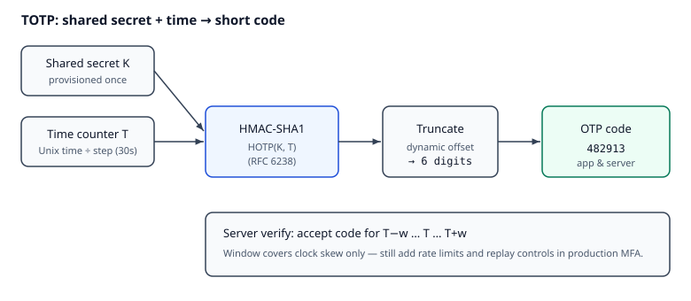

# Reading — TOTP verify

## Learning objectives

By the end of this kata’s reading + worksheet + implementation, you should be able to:

1. Explain Time-based One-Time Password (TOTP) as HMAC-based One-Time Password (HOTP) with a time-derived counter (shared secret + time step → short code).
2. State why a small verification **window** exists (clock skew) and what it does *not* replace (rate limits, replay controls).
3. Verify codes with `pyotp` instead of hand-rolling Hash-based Message Authentication Code (HMAC) — and point to RFC 6238 / Open Worldwide Application Security Project (OWASP) Multi-Factor Authentication (MFA) literacy in an interview.

## Short intro

TOTP lets a server and an authenticator app compute the same short code from a **shared secret** and the **current time** (usually a 30-second step). You do **not** need to reimplement HMAC-SHA1 for a short challenge — understand the model, then use a well-regarded library (`pyotp`) to verify codes, including a small **window** for clock skew. Production MFA still needs replay protection, rate limits, and secret storage discipline; those belong later (`02-mailguard-mfa/`).

*Figure. Shared secret **K** and time counter **T** feed HMAC; truncation yields the short code both the app and server compute. The verify **window** only covers clock skew — notice it does not replace rate limits or replay controls. Original course diagram (CC0).*

Challenge-style hiring tasks often pair a short coding exercise with **MFA/One-Time Password (OTP) research**, and prefer elegant solutions over over-engineering. That is the bar this kata trains.

## Videos (verified)

1. **[2FA: Two Factor Authentication](https://www.youtube.com/watch?v=ZXFYT-BG2So)** — Computerphile (feat. Dr Mike Pound)  
   Why it helps: crisp mental model of MFA factors (know / have / are) before you touch libraries.

2. **[How HOTP and TOTP work](https://www.youtube.com/watch?v=46AKWNOJ3-Y)** — loops  
   Why it helps: walks HMAC → truncation → counter vs Unix-time step, plus the validation **window** you’ll use in `verify`.

3. **[A Tale of Two Factors: A Deep Dive into Two Factor Authentication](https://www.youtube.com/watch?v=4wZ9jM4coV4)** — Kelley Robinson @ PyGotham 2019  
   Why it helps: compares SMS vs TOTP soft tokens and includes Python-oriented TOTP implementation notes aligned with this kata.

## Read these (verified)

### Specs & library

1. [RFC 6238 — TOTP: Time-Based One-Time Password Algorithm](https://datatracker.ietf.org/doc/html/rfc6238) — the standard behind authenticator apps (period, digits, time counter).
2. [RFC 4226 — HOTP](https://datatracker.ietf.org/doc/html/rfc4226) — TOTP builds on HOTP; skim security requirements / throttling ideas.
3. [PyOTP documentation](https://pyauth.github.io/pyotp/) — `TOTP.verify(..., valid_window=...)`, provisioning URIs; prefer this over reinventing crypto.

### Concepts & security literacy

4. [MDN — One-time passwords (OTP)](https://developer.mozilla.org/en-US/docs/Web/Security/Authentication/OTP) — email/SMS/TOTP comparison; why TOTP is preferred among OTP channels.
5. [OWASP Multifactor Authentication Cheat Sheet](https://cheatsheetseries.owasp.org/cheatsheets/Multifactor_Authentication_Cheat_Sheet.html) — MFA factors, threats, practical controls.

### Why this kata exists (career prep)

6. Identity / access-control engineering roles expect MFA literacy and concise challenge solutions — not a crypto reimplementation.
7. Cloud security SaaS products treat MFA as core product context (literacy for MailGuard’s identity path, not a clone of any vendor).

## Optional deepeners

- [National Institute of Standards and Technology (NIST) SP 800-63B-4](https://csrc.nist.gov/pubs/sp/800/63/b/4/final) (final, 31 Jul 2025; incorporates syncable authenticators / passkeys) — authenticator guidance at a high level. Companion HTML: [pages.nist.gov/800-63-4](https://pages.nist.gov/800-63-4/sp800-63b.html).
- Skim only: security considerations sections inside RFC 6238 / 4226 once the kata is green.

## Next step

Continue with the worksheet from the downloads on this page. The quiz is required after you attempt the worksheet and tests.
