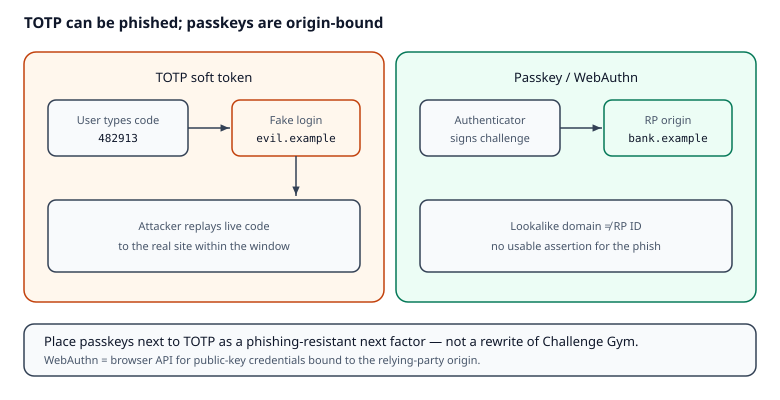

# Reading — Passkeys / WebAuthn (beside TOTP MFA)

## Learning objectives

1. Explain **Web Authentication (WebAuthn)** as a browser API for public-key credentials scoped to a relying-party **RP ID** (a registrable domain suffix), not exactly the full origin string alone.
2. Contrast phishing risk of **TOTP** (user can type a code into a fake site) vs **passkeys** (origin-bound assertion).
3. Place passkeys next to MailGuard’s TOTP path as a *next* factor — not a rewrite of Challenge Gym.

## Short intro

TOTP proves “something you have” via a shared secret — but a convincing phishing page can still harvest the live code. Passkeys use WebAuthn: the browser/OS authenticator signs a challenge for *this* origin, so a lookalike domain should not get a usable assertion.

*Figure. On the left, a typed TOTP code can be harvested and replayed. On the right, the authenticator signs only for the real relying-party origin — notice a lookalike domain does not get a usable assertion. Original course diagram (CC0).*

## Videos (verified)

1. **[Understand passkeys in 4 minutes](https://www.youtube.com/watch?v=2xdV-xut7EQ)** — Google / passkeys overview  
   Why it helps: phishing-resistant passkeys mental model in under five minutes.

2. **[Passkeys: A simpler and more secure way to log in](https://www.youtube.com/watch?v=3BmYR--3z8M)** — Google  
   Why it helps: how passkeys relate to platform authenticators without building an IdP.

Prefer MDN + W3C links below if a video moves.

## Read these (verified)

1. [MDN — Web Authentication API](https://developer.mozilla.org/en-US/docs/Web/API/Web_Authentication_API) — ceremonies and browser support.
2. [W3C WebAuthn Level 3](https://www.w3.org/TR/webauthn-3/) — Candidate Recommendation track; Level 2 is the current W3C Recommendation. Credentials are scoped to the **RP ID** (a registrable domain).
3. [passkeys.dev](https://passkeys.dev/) — practitioner-oriented passkey guidance.
4. [OWASP MFA Cheat Sheet](https://cheatsheetseries.owasp.org/cheatsheets/Multifactor_Authentication_Cheat_Sheet.html) — factors and phishing-resistant authenticators.
5. [NIST SP 800-63B-4](https://csrc.nist.gov/pubs/sp/800/63/b/4/final) (final, 31 Jul 2025; incorporates syncable authenticators / passkeys) — authenticator assurance high-level.

## Quiz (required)
[`../quizzes/passkeys_webauthn.md`](../quizzes/passkeys_webauthn.md)
