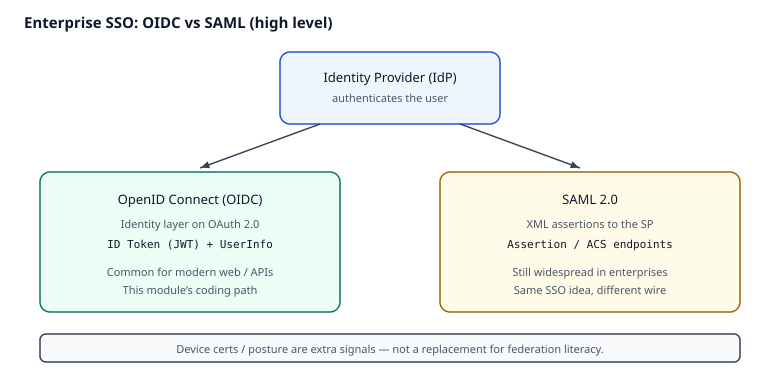

# Reading — Identity depth (SAML, device certs, password managers)

## Learning objectives

1. Compare **SAML** and **OIDC** for enterprise single sign-on (**SSO**) at a high level.
2. Explain device certificates / posture as *additional signals*, not magic.
3. Threat-model an enterprise password manager for apps that still use passwords (non-SSO).

**Why this matters.** Enterprises rarely run “OIDC only.” Without SAML literacy, device-posture signals, and a threat model for password managers on non-SSO apps, identity work stops at the happy path and fails in real estates of legacy apps. On the job, cloud and email-security admins still federate with both SAML and OIDC, and still protect vaults where SSO never arrived.

This module’s coding path is OIDC-shaped. Enterprises still run Security Assertion Markup Language (**SAML**) for many apps, issue device certificates for posture, and deploy password managers where SSO never arrived. This reading builds interview literacy without claiming you built a full Identity Provider (**IdP**).

**How it works.**

1. User authenticates at an **IdP** (password + MFA, passkey, etc.).
2. For **OIDC** apps: IdP runs an OAuth 2.0-based flow and issues identity tokens (typically JWT-shaped) the app validates (issuer, audience, signature, expiry).
3. For **SAML** apps: IdP issues a signed XML **assertion**; the service provider checks signature, audience, recipient/ACS, and time conditions, then creates a session.
4. **Device certificates / posture** add admission *signals* (managed device, healthy agent) — they do not replace user authentication.
5. Where SSO is missing, a **password manager** reduces reuse; you still model vault compromise, phishing-unlock, and shared-folder risks.



*Figure. One IdP, two common SSO wires: **OIDC** (identity layer on OAuth 2.0, JWT-shaped tokens) vs **SAML** (XML assertions). Notice the coding path here is OIDC-shaped, while enterprises still run both. Original course diagram (CC0).*

### Worked example

```text
OIDC id_token claims (shape):
  iss: https://idp.example.com/
  aud: mailguard-admin
  sub: user-42
  exp: 1730003600
  email: alex@example.com

SAML assertion checks (shape):
  Signature present + trusted cert
  Audience == SP entity ID
  Recipient/ACS == registered ACS URL
  NotOnOrAfter within skew budget
```

Same user, two wires: JSON token validation vs XML assertion conditions. Device posture might additionally require a client cert before the app accepts either.

### Common misconceptions / what goes wrong

- **“OIDC replaced SAML everywhere.”** Many enterprise apps still speak SAML; literacy for both is table stakes.
- **“A device certificate means the user is authenticated.”** Device proof is a signal; without user auth (or with a stolen unlocked device) it is not enough.
- **“Password managers eliminate phishing.”** They reduce reuse and typing into random forms, but unlock phishing, malware, and shared-vault mistakes remain — model them (OWASP secrets / MFA sheets).
- **“If SSO works in demo, federation is done.”** Audience/ACS mismatches and cert rollover are how production SSO breaks after the happy path.

## Logout and revocation (OIDC)

Login without logout design leaves sessions and refresh tokens alive after the user thinks they are done. Treat sign-out as an identity-control problem, not only a UI button.

**Why this matters.** Clearing a local cookie does not end the IdP SSO session, and an unrevoked **refresh token** can mint new access tokens. On the job, admin portals and DLP consoles need honest logout notes: RP-initiated logout, token revocation, and what you still cannot kill (already-issued access tokens until they expire).

**How logout / revocation works.**

1. **App session end.** The relying party deletes its own session cookie / server session.
2. **RP-initiated logout.** Redirect the browser to the IdP `end_session_endpoint` with `id_token_hint` and a registered `post_logout_redirect_uri` so the IdP session ends too ([OIDC RP-Initiated Logout](https://openid.net/specs/openid-connect-rpinitiated-1_0.html)).
3. **Refresh-token revoke.** Call the IdP `revocation_endpoint` with the refresh token ([RFC 7009](https://www.rfc-editor.org/rfc/rfc7009)) so silent renew fails after logout.
4. **Access-token lifetime.** Short-lived access tokens still work until `exp` unless you add introspection or a denylist — document that gap honestly.
5. **Lab practice.** Use the local Keycloak lab ([`keycloak_lab.md`](./keycloak_lab.md)) to click through end-session and revocation against discovery document URLs.

### Worked example (logout shape)

```text
1. User clicks Sign out in MailGuard admin
2. App deletes local session
3. Browser → GET {end_session_endpoint}
     ?id_token_hint=<current id_token>
     &post_logout_redirect_uri=http://127.0.0.1:3000/
4. App → POST {revocation_endpoint}
     token=<refresh_token>&token_type_hint=refresh_token
5. Result: IdP SSO cookie cleared; refresh renew fails; access token dies at exp
```

### Misconceptions (logout)

- **“Logout is only a front-end route change.”** Without IdP logout + refresh revoke, SSO bounce-back and renew keep the user in.
- **“Revoking the refresh token kills the current access token instantly.”** Access tokens are usually bearer until expiry unless you add extra controls.
- **“Back-channel logout is required for every lab.”** Useful in multi-tab estates; start with RP-initiated logout + revoke, then read Keycloak/OIDC back-channel docs as a deepen.

## Videos (verified)

1. **[OAuth 2.0 and OpenID Connect (in plain English)](https://www.youtube.com/watch?v=996OiexHze0)** — OktaDev  
   Why it helps: OIDC as identity layer on OAuth — revisit before SAML compare.

2. Prefer the OWASP SAML + OAuth cheat sheets below for the SAML vs OIDC compare (video IDs bitrot). Optional: search “SAML vs OIDC” from IdP vendor developer channels and cross-check against OWASP.

Prefer written RFCs/docs below if videos move.

## Read these (verified)

1. [OWASP — SAML Security Cheat Sheet](https://cheatsheetseries.owasp.org/cheatsheets/SAML_Security_Cheat_Sheet.html)
2. [OWASP — OAuth 2.0 / OIDC related cheat sheets](https://cheatsheetseries.owasp.org/cheatsheets/OAuth2_Cheat_Sheet.html)
3. [OASIS — SAML 2.0 Technical Overview](https://docs.oasis-open.org/security/saml/Post2.0/sstc-saml-tech-overview-2.0.html) — assertions, bindings, and SSO flows.
4. [MDN — Authentication overview](https://developer.mozilla.org/en-US/docs/Web/Security/Authentication) — browser auth landscape; for mTLS see [Cloudflare Learning — What is mutual TLS?](https://www.cloudflare.com/learning/access-management/what-is-mutual-tls/).
5. [NIST SP 800-63B-4](https://csrc.nist.gov/pubs/sp/800/63/b/4/final) (final, 31 Jul 2025; incorporates syncable authenticators / passkeys) — authenticators & federation high-level. Companion HTML: [pages.nist.gov/800-63-4](https://pages.nist.gov/800-63-4/sp800-63b.html).
6. [OWASP — Secrets Management Cheat Sheet](https://cheatsheetseries.owasp.org/cheatsheets/Secrets_Management_Cheat_Sheet.html) — why vaults beat spreadsheets (for apps still on passwords). For server-side password hashing see [Password Storage Cheat Sheet](https://cheatsheetseries.owasp.org/cheatsheets/Password_Storage_Cheat_Sheet.html).

## Quiz (required)
[`../quizzes/identity_depth.md`](../quizzes/identity_depth.md)
