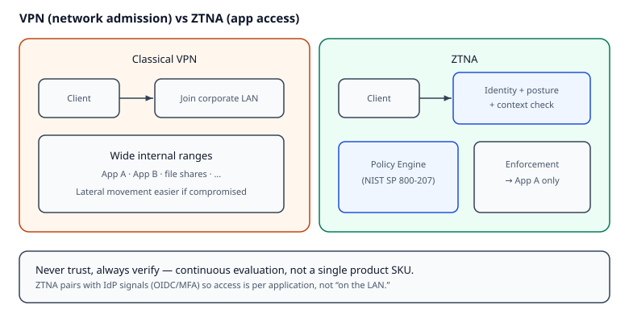

# Reading — ZTNA lite

## Learning objectives

1. Define **Zero Trust** as “never trust, always verify” with continuous evaluation — not a single product SKU.
2. Contrast network-level **VPN** admission with application-level **ZTNA**.
3. Name Policy Engine / Policy Enforcement Point ideas from National Institute of Standards and Technology (**NIST**) SP 800-207 at a high level.

## Short intro

Classical remote access: join a VPN, then reach wide internal ranges. If malware or a stolen laptop lands on that network, **lateral movement** is easier. Zero Trust Network Access (**ZTNA**) aims to grant access to *specific applications* after verifying user identity, often device posture, and context — ideally without parking the client on a flat corporate LAN.

*Figure. VPN admits the client onto a broad LAN (lateral movement risk). ZTNA checks identity/posture/context, then a Policy Engine / Enforcement Point grants **per-app** access — notice “never trust, always verify,” not a single product SKU. Original course diagram (CC0).*

MailGuard modules already practice app identity (TOTP, OIDC). ZTNA is the *network/access path* story that enterprises pair with identity providers.

## Videos (verified)

1. **[What Is Zero Trust Architecture (ZTA)? NIST 800-207 Explained](https://www.youtube.com/watch?v=5Kq64vOgE10)**  
   Why it helps: policy engine vs enforcement point vocabulary.

2. **[Zero Trust, Before The Cloud (Bsides-style talk)](https://www.youtube.com/watch?v=M0Pb8GNxWl8)** — Ben Lintern  
   Why it helps: identity-aware networking vs “VPN then flat access,” with practical skepticism.

## Read these (verified)

1. [NIST SP 800-207 — Zero Trust Architecture](https://csrc.nist.gov/pubs/sp/800/207/final) — abstract + section on ZTA components.
2. [NIST Zero Trust Architecture portal](https://www.nist.gov/publications/zero-trust-architecture) — publication landing.
3. [NCSC (UK) — Zero trust architecture design principles](https://www.ncsc.gov.uk/collection/zero-trust-architecture) — pragmatic principles.
4. [Cloudflare Learning — What is ZTNA?](https://www.cloudflare.com/learning/access-management/what-is-ztna/) — plain-language ZTNA vs VPN (vendor learning site; read for concepts).

## Self-check

[`../quizzes/ztna_lite.md`](../quizzes/ztna_lite.md)
