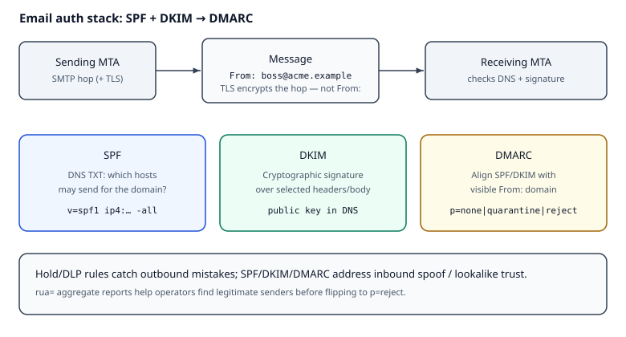

# Reading — Email authentication & SMTP/TLS literacy

## Learning objectives

1. Explain Simple Mail Transfer Protocol (**SMTP**) as the store-and-forward *sending* protocol, and why Transport Layer Security (**TLS**) on SMTP encrypts a hop but does **not** by itself prove the `From:` domain is legitimate. Server-to-server STARTTLS is **opportunistic**: an active attacker can strip it, and certificates are often not validated. **MTA-STS** (RFC 8461) or **DANE** (RFC 7672) make TLS required and authenticated for a receiving domain, and **TLS-RPT** (RFC 8460) reports failures. Implicit TLS (port 465) applies to client submission (RFC 8314), not MX-to-MX.
2. Distinguish Sender Policy Framework (**SPF**), DomainKeys Identified Mail (**DKIM**), and Domain-based Message Authentication, Reporting and Conformance (**DMARC**) — what each checks and how they combine. DMARC passes if **at least one** of SPF or DKIM passes **and** aligns with the visible `From:`.
3. Read a DMARC DNS policy (`p=`, `rua=`, and RFC 9989 tags such as `t=` / `np=` / `psd=`) and say what hold/DLP rules **cannot** fix alone when attackers spoof lookalike mail.

**Why this matters.** Hold/DLP rules catch *outbound* mistakes (missend, policy); they do not stop attackers who **spoof** your (or a partner’s) domain into someone else’s inbox. Without SPF/DKIM/DMARC, receivers cannot tell authorized mail from lookalike fraud. On the job, email and cloud-security teams publish DNS auth, read aggregate reports, and step `p=` carefully — TLS on SMTP encrypts a hop but does not prove `From:`.

Attackers also **spoof inbound or lookalike domains**. SPF publishes which hosts may send for the **envelope sender (MAIL FROM / Return-Path) or HELO domain** — it does **not** check the header `From:`. DKIM adds a cryptographic signature over selected headers/body with a public key in DNS. DMARC adds the **alignment** check that ties SPF or DKIM to the visible `From:` domain, tells receivers what to do on failure (`p=`), and where to send aggregate reports (`rua`).

**How it works.**

1. **SMTP hop.** The sending MTA transfers the message to the next hop (often the receiving MX). Optional TLS on that connection encrypts the pipe for *that* hop only.
2. **SPF check.** The receiver looks up the SPF TXT for the envelope sender domain (MAIL FROM / Return-Path) or HELO identity and asks: is this connecting IP authorized? SPF does **not** inspect the header `From:`.
3. **DKIM verify.** The receiver finds a `DKIM-Signature` header, fetches the public key from DNS (`selector._domainkey.domain`), and verifies the signature over the signed headers and body. Prefer **RSA keys ≥ 2048 bits** and **`a=rsa-sha256`** (do **not** use SHA-1 signing algorithms). **Ed25519** DKIM (`k=ed25519`) is increasingly supported as a smaller alternative where receivers accept it — publish and test before relying on it alone.
4. **DMARC alignment.** The receiver takes the visible `From:` domain and asks whether SPF and/or DKIM **passed and aligned** with that domain (organizational or strict, per policy). At least one aligned pass is enough for DMARC pass.
5. **Policy + reports.** On failure, the published `p=` (`none` / `quarantine` / `reject`) guides disposition; `rua=` collects aggregate reports so operators can fix legitimate senders before tightening.

```text
Sender MTA --SMTP(+TLS?)--> Receiver MTA
                              |-- SPF: envelope/HELO vs IP (DNS TXT)
                              |-- DKIM: signature vs DNS pubkey
                              `-- DMARC: align SPF|DKIM with From: → p=/rua
```

**SMTP + TLS** literacy: encrypting the pipe (TLS) stops casual eavesdropping on that hop; it does not replace SPF/DKIM/DMARC. Between MTAs, STARTTLS is opportunistic unless MTA-STS or DANE enforces authenticated TLS. Domain authentication is how receivers decide “did this domain authorize this message?”

### Worked example

DNS (illustrative):

```text
example.com.            TXT  "v=spf1 ip4:203.0.113.10 -all"
selector._domainkey.example.com.  TXT  "v=DKIM1; k=rsa; p=<RSA-2048-or-larger-pubkey>"
# Optional second selector when receivers support Ed25519:
# ed25519._domainkey.example.com. TXT "v=DKIM1; k=ed25519; p=<Ed25519-pubkey>"
_dmarc.example.com.     TXT  "v=DMARC1; p=quarantine; rua=mailto:dmarc@example.com"
```

Message shape the receiver sees:

```text
Return-Path: <bounce@example.com>
From: Billing <billing@example.com>
DKIM-Signature: v=1; a=rsa-sha256; d=example.com; s=selector;
    h=from:to:subject:date; bh=...; b=...
# Prefer rsa-sha256 (or ed25519-sha256 where published); do not use rsa-sha1.
```

If the connecting IP is `203.0.113.10`, SPF can pass for `example.com`. If the DKIM signature verifies with `d=example.com`, DKIM passes. DMARC then checks alignment of those results with header `From:` (`example.com`). A spoofed `From: billing@example.com` sent from an unauthorized IP *without* a valid aligned DKIM signature fails DMARC even if the hop used TLS.



*Figure. SMTP+TLS protects the hop; **SPF** authorizes envelope hosts, **DKIM** signs content, **DMARC** aligns results with the visible `From:` and sets `p=` policy. Notice hold/DLP and domain auth solve different problems (outbound mistakes vs inbound spoof). Original course diagram (CC0).*

### Common misconceptions / what goes wrong

- **“TLS on SMTP means the From: is trusted.”** TLS encrypts (and maybe authenticates) the *transport hop*; it says nothing about who is allowed to use the domain in `From:`. That is SPF/DKIM/DMARC’s job.
- **“SPF checks the From: header.”** SPF evaluates the envelope sender / HELO against the connecting IP. Attackers can put any address in `From:` while using a different MAIL FROM — without DMARC alignment, SPF alone does not stop that.
- **“STARTTLS between MTAs is always enforced.”** Server-to-server STARTTLS is opportunistic unless MTA-STS or DANE require authenticated TLS; an active attacker can strip it, and many hops never validate certificates.
- **“Flip to p=reject on day one.”** Aggregate reports (`rua=`) exist so you find legitimate relays missing SPF/DKIM/alignment before reject breaks payroll or marketing.
- **“Any RSA key and SHA-1 DKIM are fine.”** Use **RSA ≥ 2048** and avoid **SHA-1** signing algorithms; prefer `rsa-sha256`, and consider an **Ed25519** selector where your receivers verify it (RFC 6376 + current operator guidance).

## Videos (verified)

1. **[SPF, DKIM and DMARC Protocols Explained](https://www.youtube.com/watch?v=2eR6996cQvY)** — PowerDMARC  
   Why it helps: end-to-end picture of the three DNS-published controls receivers combine.

2. **[Email Trust and Antispoofing: DKIM, SPF, and DMARC](https://www.youtube.com/watch?v=ZFg691hXDzk)** — Salesforce Support  
   Why it helps: operator-oriented setup narrative (`p=none` → stricter policies) without requiring their product.

3. **[Set up email authentication](https://www.youtube.com/watch?v=YdWgHAcD91E)** — Google Workspace  
   Why it helps: SPF/DKIM publish steps and where DMARC fits for modern receivers.

## Read these (verified)

1. [RFC 7208 — SPF](https://datatracker.ietf.org/doc/html/rfc7208) — skim abstract + mechanism overview (MAIL FROM / HELO identity).
2. [RFC 6376 — DKIM](https://datatracker.ietf.org/doc/html/rfc6376) — signature + public key in DNS. Operator practice: **RSA ≥ 2048**, no **SHA-1** (`rsa-sha1`); **Ed25519** (`k=ed25519`) where supported.
3. [RFC 9989 — DMARC](https://www.rfc-editor.org/info/rfc9989) — current protocol (Standards Track; obsoletes RFC 7489 and RFC 9091). Companion: [RFC 9990](https://www.rfc-editor.org/info/rfc9990) (aggregate reports), [RFC 9991](https://www.rfc-editor.org/info/rfc9991) (failure reports). RFC 9989 removes `pct`/`rf`/`ri` and adds `t` (test mode), `np`, and `psd`; the Public Suffix List is replaced by a DNS tree walk.
4. [DMARC.org overview](https://dmarc.org/overview/) — plain-language diagram.
5. [Cloudflare Learning — What are DMARC, DKIM, and SPF?](https://www.cloudflare.com/learning/email-security/dmarc-dkim-spf/) — concise comparison.
6. [Google — Email sender guidelines](https://support.google.com/a/answer/81126) — modern receiver expectations (SPF/DKIM/DMARC).
7. [Cloudflare Learning — What is SMTP?](https://www.cloudflare.com/learning/email-security/what-is-smtp/) — SMTP + why encryption ≠ authentication.
8. [RFC 8461 — MTA-STS](https://datatracker.ietf.org/doc/html/rfc8461) · [RFC 8460 — TLS-RPT](https://datatracker.ietf.org/doc/html/rfc8460) · [RFC 7672 — DANE for SMTP](https://datatracker.ietf.org/doc/html/rfc7672) — authenticated/required SMTP TLS and failure reporting.

### Aggregate reports (DMARC report literacy)

Receivers email XML **aggregate reports** to `rua=` addresses summarizing pass/fail by source IP. Operators use them to find legitimate senders missing SPF/DKIM (or alignment) before flipping `p=reject`. This course does not require a live domain — parse policies in the kata and describe what a report would tell you on the assignment.

## Next step

Continue with the assignment from the downloads on this page. The quiz is required after you attempt the assignment and tests.
