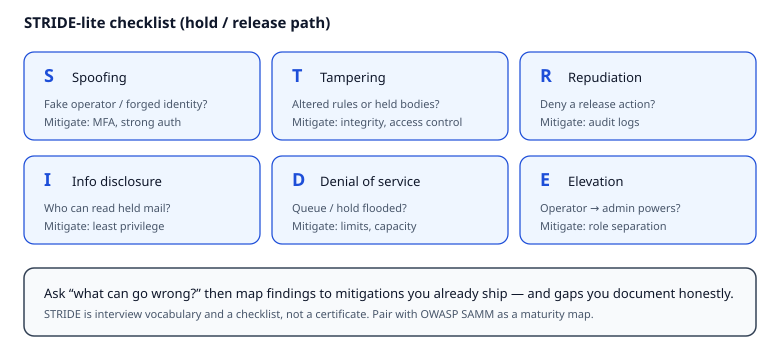

# Reading — Threat modeling & lightweight secure SDLC

## Learning objectives

1. Apply a **STRIDE**-lite pass to MailGuard’s hold/release path (who can spoof an operator? tamper with rules? deny the queue?).
2. Relate findings to mitigations you already ship (MFA, audit logs, first-match rules, CI) and gaps you document honestly.
3. Map one finding to **NIST SSDF** / **OWASP ASVS** evidence (and optionally **OWASP SAMM** as a maturity *map*) — pick one practice to improve next.

**Why this matters.** Shipping hold/release without naming abuse stories leaves gaps that MFA, audits, and CI cannot invent for you. Teams that skip threat modeling discover spoofed operators, silent rule tampering, and held-body disclosure in production — after users are affected. A lightweight pass costs a page of Markdown; a missed elevation path costs incident response.

**How it works.**

1. **What are we working on?** Sketch the hold/release path and trust boundaries (browser → admin/API → rule store → queue → next hop).
2. **What can go wrong?** Walk **STRIDE** against each element: Spoofing, Tampering, Repudiation, Information disclosure, Denial of service, Elevation of privilege (Microsoft-origin checklist — see [STRIDE reference](https://learn.microsoft.com/en-us/azure/security/develop/threat-modeling-tool-threats)).
3. **What are we doing about it?** Map each abuse story to a mitigation you ship (MFA, audit logs, first-match tests, least privilege) or mark an honest gap.
4. **Did we do a good job?** Revisit when the design changes; Secure Software Development Life Cycle (**SDLC**) means these questions recur in requirements, design, implementation, test, and operate — not only in a final pen-test fantasy.
5. **Privacy sibling:** **LINDDUN** is privacy-oriented; for MailGuard, focus on disclosure of held message bodies and audit access ([LINDDUN](https://www.linddun.org/)).
6. **Secure SDLC evidence (prefer for reviews):** map at least one mitigation to [NIST SP 800-218 SSDF](https://csrc.nist.gov/pubs/sp/800/218/final) (e.g. *Produce well-secured software* / *Respond to vulnerabilities*) and one [OWASP ASVS](https://owasp.org/www-project-application-security-verification-standard/) requirement class (e.g. V4 Access Control, V7 Error Handling and Logging). **Why:** auditors and RFPs ask for *evidence* of practices, not a blank “we follow best practices.”
7. **Maturity map (optional):** **OWASP SAMM** maps five business functions (Governance, Design, Implementation, Verification, Operations) so you pick *one* practice to improve — not claim enterprise maturity ([OWASP SAMM](https://owasp.org/www-project-samm/)).

```
Shostack four questions
  → STRIDE (or LINDDUN-lite) rows on the diagram
  → mitigations / gaps
  → SSDF practice + ASVS class as evidence (SAMM optional: one practice to raise next)
```

### Worked example

One STRIDE-lite row for MailGuard’s hold path:

| Element | STRIDE | Abuse story | Mitigation or gap |
|---------|--------|-------------|-------------------|
| Operator session | Spoofing | Attacker uses a stolen session to approve holds | MFA + short-lived session; gap if admin has no step-up on release |
| Rule store | Tampering | Quiet edit flips first-match order to silent allow | Audit log on rule write + CI tests for evaluate order |
| Held body | Information disclosure | Support role reads full message body | Least privilege / redacted preview; document if full body is required |
| Release API | Elevation of privilege | Low-privilege user calls `POST /holds/{id}/release` | Authz check on hold id (tenant + role); 403 on miss — **ASVS** access-control; **SSDF** PW.1 / secure design |
| Concurrent approve | Tampering / Repudiation | Two operators both “win” release; audit missing | One-winner `UPDATE … WHERE state=…` + audit in same txn (Module 06a) |

**Evidence sketch (SSDF / ASVS):** Tenant-scoped release + immutable audit maps to ASVS access-control + logging requirements and to SSDF practices that produce verifiable secure software (design constraints + evidence you can show in a review). Keep SAMM as an optional maturity *map* if you want a self-score — do not treat any of these as a certificate.

**On the job.** Email and identity gateways always have privileged operator actions (release, rule edit). Interviewers and security reviews expect you to walk a trust-boundary diagram and name STRIDE rows with mitigations or honest gaps — vendor-neutral vocabulary that transfers across cloud mail and SaaS admin consoles.

## Short intro

Threat modeling asks “what can go wrong?” before or while you build. Secure Software Development Life Cycle (**SDLC**) means security activities show up in requirements, design, implementation, test, and operate — not only in a final pen-test fantasy.

**STRIDE** (Spoofing, Tampering, Repudiation, Information disclosure, Denial of service, Elevation of privilege) is a Microsoft-origin checklist still useful as interview vocabulary. **LINDDUN** is a privacy-oriented sibling; for MailGuard, focus on disclosure of held message bodies and audit access. Prefer a short table over an unused enterprise tool: six abuse stories tied to MailGuard’s hold path beat a blank “we follow best practices.”



*Figure. Six STRIDE categories as a lightweight checklist on the hold/release path. Notice each tile pairs a threat question with a mitigation you may already ship (MFA, audit logs, least privilege) — document gaps honestly. Original course diagram (CC0).*

### Trade-offs

| Approach | When it helps | Cost / limit |
|----------|---------------|--------------|
| STRIDE-lite table | Fast feature reviews | Misses privacy-specific linking threats (use LINDDUN-lite) |
| Full threat-modeling tools | Regulated programs | Overhead for a student kata |
| Pen-test only at the end | Finds some bugs | Too late for design-level trust boundaries |

### Common misconceptions / what goes wrong

- **“We have MFA and audit logs, so we already threat-modeled.”** Controls without named abuse stories leave blind spots (e.g. rule-order tampering) that MFA never covers.
- **“STRIDE is obsolete / only for Microsoft stacks.”** It is a vocabulary checklist; the point is coverage of spoof/tamper/disclose/elevate on *your* diagram, not a product allegiance.
- **“SAMM / SSDF / ASVS means we are mature.”** They are maps and verification catalogs. Inflating scores without evidence fails reviews; pick one practice or requirement class and show a concrete next step (test, CI gate, audit row).
- **“Privacy is separate from security threat modeling.”** Held bodies and audit access are disclosure risks — LINDDUN-lite belongs on the same page as STRIDE for a gateway.

## Videos (verified)

1. **[Threatmodcon keynote (segment)](https://www.youtube.com/watch?v=4ngYKVAs22c)** — Adam Shostack  
   Why it helps: threat modeling as a practice; pairs with the four-question frame in writing.

2. **[Keynote: Stop Trying to "Manage Risk"](https://www.youtube.com/watch?v=THSfJIlPGPk)** — Adam Shostack  
   Why it helps: connects threat modeling judgment to delivery — not spreadsheet theater.

Also skim: [Shostack + Associates — threat modeling beginner guide](https://adam.shostack.org/resources/threat-modeling) (four questions).

## Read these (verified)

1. [OWASP Threat Modeling](https://owasp.org/www-community/Threat_Modeling) — community overview.
2. [OWASP Threat Modeling Cheat Sheet](https://cheatsheetseries.owasp.org/cheatsheets/Threat_Modeling_Cheat_Sheet.html) — practical steps.
3. [Microsoft — STRIDE](https://learn.microsoft.com/en-us/azure/security/develop/threat-modeling-tool-threats) — threat categories reference.
4. [NIST SP 800-218 — SSDF](https://csrc.nist.gov/pubs/sp/800/218/final) — Secure Software Development Framework practices and example evidence.
5. [OWASP ASVS](https://owasp.org/www-project-application-security-verification-standard/) — verification requirements (access control, logging, session).
6. [OWASP SAMM](https://owasp.org/www-project-samm/) — optional maturity map: **Governance**, Design, Implementation, Verification, Operations.
7. [LINDDUN](https://www.linddun.org/) — privacy threat categories (skim).
8. [Shostack four-question frame (GitHub)](https://github.com/adamshostack/4QuestionFrame) — one-pager.

## Next step

Continue with the assignment from the downloads on this page. The quiz is required after you attempt the assignment.
